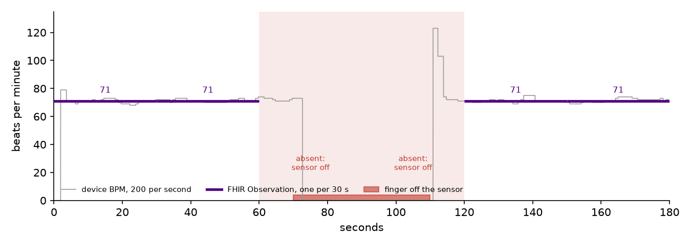

# pulse-fhir-gateway

Takes the serial stream from my [pulse monitor](https://github.com/Henrycarto/pulse-monitor-avr)
(200 readings per second over USB) and turns it into FHIR R4 heart-rate
Observations that a hospital system can store and query. Every reading reaches
the server once. Not zero times because the network dropped, and not twice
because a retry went through after a timeout.



*The firmware's rate stream (grey) and the Observations the gateway sends (purple), on a
3-minute recording where the finger leaves the sensor from 70 to 110 s. Those two intervals
are sent as "not performed" with the reason, not as a number. The spike at 111 s is the
firmware reacquiring the pulse; it never reaches the record.*

## What it does

```
pulse monitor ──USB──> parse ──> 30 s windows ──> FHIR transaction ──> outbox ──> FHIR server
 "452,500,723"         drop bad    median BPM,      Device + N             SQLite     HAPI, or any
                       lines       coverage check   Observations,          queue      R4 server
                                                    conditional creates
```

- **One value per interval, not 200 per second.** Each 30 s window becomes one Observation
  with an `effectivePeriod`. The value is the median of the device's rate, so a reacquisition
  spike or a missed beat does not move it. Time comes from counting samples at the firmware's
  exact 200 Hz, not from USB arrival times, which come in bursts.
- **No number when the data does not support one.** If the sensor gave a valid rate for less
  than 80% of the window, or the median is outside 25 to 250 BPM, the Observation carries a
  `dataAbsentReason` and says why ("Sensor gave a valid rate for 42% of the interval"). A
  record with a gap is honest. A record with an invented 71 is not.
- **Standard coding.** FHIR R4 heart rate profile: LOINC `8867-4`, category `vital-signs`,
  UCUM `/min`, and a `Device` resource so every value traces back to the hardware that made it.
  Every resource carries a generated narrative and every Observation names the patient as
  performer, so the official HL7 validator reports no errors and no warnings about the content.
- **Idempotent delivery.** Each Observation gets a deterministic identifier (UUIDv5 of device
  serial and window start) and is sent as a conditional create (`ifNoneExist`). Sending the
  same window twice stores it once. The integration test replays the same recording twice
  against a real HAPI FHIR server and checks there are still exactly six Observations and one
  Device.
- **Nothing lost when the server is down.** Bundles go into a SQLite outbox and are deleted
  only after the server accepts them. Network errors, 429 and 5xx are retried with backoff
  (and `Retry-After` is honoured). A bundle the server rejects with a 4xx moves to a
  dead-letter table with the server's `OperationOutcome`, so one bad bundle cannot block the
  queue.

## Run it

```bash
pip install -e ".[dev,serial]"

# dry run: write the FHIR bundles to ./out
pulse-fhir replay fixtures/dropout.txt.gz --start 2026-10-16T09:00:00+02:00 \
    --subject Patient/example --device-serial PM-001

# against a local HAPI FHIR server
docker run -p 8080:8080 hapiproject/hapi:v8.12.0-2
pulse-fhir replay fixtures/rest.txt.gz --start 2026-10-16T09:00:00+02:00 \
    --subject "Patient?identifier=https://example.org/mrn|12345" \
    --device-serial PM-001 --fhir http://localhost:8080/fhir

# live from the device
pulse-fhir serial /dev/ttyACM0 --subject Patient/123 --device-serial PM-001 --fhir http://localhost:8080/fhir
```

`--subject` takes a literal reference or a conditional one, so the gateway can attach readings
to a patient by hospital identifier without knowing the server's internal id. Set `FHIR_TOKEN`
to send a bearer token.

## Tests

| Layer | What it checks | Where |
|---|---|---|
| Unit (31) | parsing, windowing on real firmware output, profile rules, stable identifiers, retry, outbox ordering, dead letter, restart | `pytest` |
| Structure | every resource parses with `fhir.resources` | `tests/test_fhir.py` |
| Official validator | `examples/` checked by the HL7 FHIR validator against R4 4.0.1 and the heart rate profile | CI job `hl7-validator` |
| Integration | replay twice into HAPI FHIR, count Observations and Devices, check reference resolution | CI job `hapi-integration` |

The fixtures in `fixtures/` are not hand-written. They were produced by running the pulse
monitor's detector firmware, compiled unchanged on the host, on synthetic PPG signals from
that repository's scenario generator (rest at 72 BPM, an exercise step from 62 to 112 BPM, and
a 40 s sensor dropout), then formatted exactly as the firmware writes them to serial.

## Limits

- The device is a teaching prototype, not a medical device. The FHIR is correct; the
  measurement behind it is not clinically validated.
- Auth is a static bearer token. A production deployment would use SMART Backend Services
  (client credentials with a signed JWT), which this does not implement.
- One device and one patient per process. Device-to-patient association is a command-line
  argument, not a workflow.
- Live mode anchors time to the host clock at start and then counts samples. Over long
  sessions the device's crystal and the host clock drift apart; this is not corrected.

See [`docs/DESIGN.md`](docs/DESIGN.md) for the reasoning behind each decision.

## Author

Samuel Henry Mba
