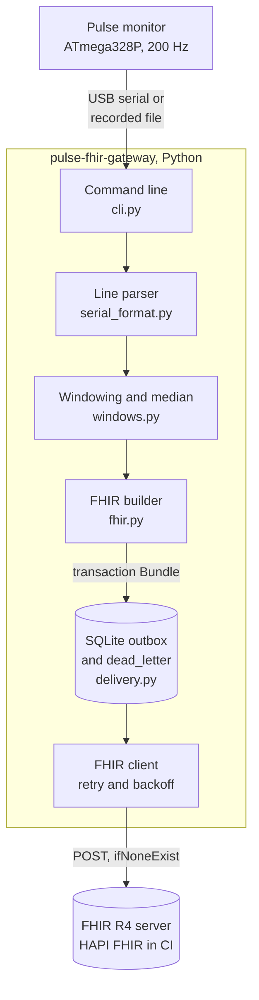
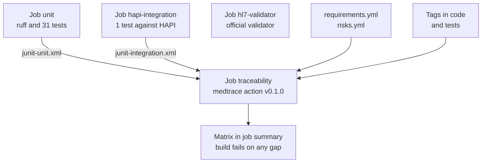

# pulse-fhir-gateway and medtrace, explained

This is a plain-language guide to what pulse-fhir-gateway is, why it exists and how it is built, together with medtrace, the separate tool that checks in every build that the gateway's requirements and risks are covered by passing tests. You do not need a background in healthcare or software to follow it. Technical terms are explained the first time they appear, and every term is in the [glossary](#glossary) at the end. For a longer explanation of the health IT standards mentioned here, see the [Health IT primer](https://github.com/Henrycarto/passayge/blob/main/docs/HEALTH_IT_PRIMER.md).

## In one sentence

pulse-fhir-gateway turns the raw stream of a home-built pulse monitor into standard heart-rate records that a hospital system can store, delivering each one exactly once, and medtrace fails the build if any of its requirements or risks is not backed by a test that passed.

## In one paragraph

A small pulse monitor (a finger sensor on an ATmega328P microcontroller, from the author's [pulse-monitor-avr](https://github.com/Henrycarto/pulse-monitor-avr) project) sends 200 lines of text per second over USB. No hospital record wants 200 numbers a second. pulse-fhir-gateway reads that stream, cuts it into 30-second windows, takes the median heart rate of each window and writes it as a FHIR Observation (FHIR is the modern web standard for health data; an Observation is its record for one measurement). When the sensor was off the finger for too much of a window, it writes no number at all, but a record that says "not performed" and why. The records are sent to a FHIR server in a way that survives network failures: they wait in a local queue until the server confirms them, and each carries a fixed identifier so that sending one twice still stores it once. The gateway is specified as 14 written requirements and 6 analysed risks, and every function and test is tagged with the requirement it implements or verifies. medtrace is a second, reusable tool that reads those tags and the real test results and fails the build when a link is missing or a test did not pass. Together they show the two halves of medical device software work: getting the data right, and proving it.

## The real-world problem

### A short story

Elif Kovačević is 58 and recovering at home in Linz after a heart procedure. (She is fictional, as is everyone in this document.) Her cardiology team asks her to wear a finger pulse sensor for a few hours each morning, so they can see her resting heart rate trend without a clinic visit. One morning she takes the sensor off for 40 seconds to answer the door. That afternoon the clinic's internet connection drops for ten minutes.

Three questions come up:

1. **What should the record show for the 40 seconds the sensor was off?** If the software averages what it had, a normal-looking 71 appears for a period when nothing was measured. A nurse reading the chart cannot tell.
2. **What happens to the readings taken while the connection was down?** If they are lost, the gap looks like "nothing happened". If the software resends them after a timeout and the first attempt had actually arrived, they are stored twice and the trend is distorted.
3. **How does the team know the software really does what its specification says?** "We tested it" is not an answer an auditor accepts. They want to see which test checks which requirement, and that those tests passed on the version in use.

### What goes wrong

- **Too much data, in the wrong shape.** The device produces 720,000 readings per hour ([docs/DESIGN.md](DESIGN.md)). A hospital record expects one value per interval, coded so any system can read it.
- **Missing data looks like real data.** A sensor that is off reports 0. Averaging around the zeros gives a plausible number that is not a measurement.
- **Networks fail at the worst time.** A sender often cannot tell whether a request arrived. Retrying blindly duplicates; not retrying loses data.
- **Traceability lives in spreadsheets.** In medical device software, teams must show the chain from risk to requirement to code to passing test. That chain is usually kept by hand and is out of date the day after an audit ([medtrace README](https://github.com/Henrycarto/medtrace/blob/main/README.md)).

pulse-fhir-gateway addresses the first three; medtrace addresses the fourth.

## The healthcare background you need

Short definitions follow. The [Health IT primer](https://github.com/Henrycarto/passayge/blob/main/docs/HEALTH_IT_PRIMER.md) explains each one in more depth.

**FHIR (Fast Healthcare Interoperability Resources).** A standard from HL7 International for exchanging health data over the web. Data is split into "resources" such as Patient, Observation or Device, each a small JSON document with a fixed shape, read and written with ordinary web requests. This project uses FHIR R4 (release 4, version 4.0.1). Think of standard shipping containers: any port can handle them because the shape is agreed in advance.

**Observation, Device and Bundle.** An Observation is one measurement: what was measured, for whom, when, and the value. A Device describes the hardware that made it. A Bundle carries several resources together; a "transaction" Bundle asks the server to store all of them or none. Think of a lab slip (Observation), the machine's label (Device) and the envelope they are posted in (Bundle).

**Vital signs profile and the heart rate profile.** A profile is a set of extra rules on top of a FHIR resource. FHIR R4 itself defines a heart rate profile (`http://hl7.org/fhir/StructureDefinition/heartrate`): the Observation must use LOINC code 8867-4, the category "vital-signs", the unit "/min", and must have either a value or a reason why there is none (rule "vs-2"). It is like a form with boxes you are not allowed to leave empty.

**LOINC and UCUM.** LOINC is a catalogue of codes for measurements, so "Heart rate" is `8867-4` everywhere. UCUM is the standard for units, so "beats per minute" is written `/min`. Codes and units are what let a different hospital system read the value without a custom mapping, the way a postcode works in any sorting office.

**dataAbsentReason.** FHIR's built-in way to say "there is no value, and here is why", for example "not-performed" or "error". A blank on a form with a note in the margin is honest; a made-up number is not.

**Photoplethysmography (PPG).** The finger sensor shines light through the skin and measures how much comes back; each heartbeat changes the blood volume and so the signal. The firmware detects beats in that signal and reports a rate. When the finger is removed, there is no pulse to detect and the firmware reports 0.

**HAPI FHIR.** A widely used open-source FHIR server written in Java. The project's integration test runs against it, image `hapiproject/hapi:v8.12.0-2`.

**The HL7 FHIR validator.** The official command-line tool from HL7 that checks a resource against the FHIR specification and its profiles and reports errors, warnings and information messages. CI runs version 7.0.2.

**Idempotency.** An operation is idempotent if doing it twice has the same effect as doing it once. Here, "create this Observation unless one with this identifier already exists" is idempotent. Think of a lift button: pressing it five times still calls one lift.

**Outbox and dead letter.** An outbox is a local queue where outgoing data waits until the receiver confirms it. A dead-letter store is where data goes that the receiver refuses for good, so a person can look at it instead of it blocking the queue. Think of a post tray on your desk, and the post office's undeliverable mail department.

**Medical device software, IEC 62304 and ISO 14971.** Software with a medical purpose can be a medical device under the EU MDR (Medical Device Regulation). IEC 62304 is the life-cycle standard for such software and asks for traceability between requirements, tests and risk controls. ISO 14971 is the risk management standard: each hazard leads to a hazardous situation and then to harm, scored by severity and probability before and after controls. The pulse monitor is explicitly not a medical device; the project uses these structures as practice. Think of building regulations: the more dangerous the building, the more inspections, and the inspector wants the paperwork.

**Traceability.** Being able to follow each requirement to the code that implements it and the test that verifies it, and each risk to the requirement that controls it. Think of a parcel tracking number for every promise in the specification.

## What it does, step by step

Here is one full journey, using the recording in `fixtures/dropout.txt.gz`: three minutes at rest, with the finger off the sensor from 70 to 110 seconds.

1. **The device streams text.** Each line looks like `452,500,723`: the raw sensor value (0 to 1023), the beat LED (500 when on, 0 when off) and the rate times ten (72.3 BPM). One line per sample, exactly 200 per second, at 115200 baud. The format is defined in the firmware's `serial_format.h` in pulse-monitor-avr.
2. **The gateway reads lines** from a recorded file (`pulse-fhir replay`) or the live USB port (`pulse-fhir serial`), in [pulse_fhir/cli.py](../pulse_fhir/cli.py).
3. **Bad lines are dropped.** `parse_line()` in [pulse_fhir/serial_format.py](../pulse_fhir/serial_format.py) accepts only three integers in the firmware's ranges. A half line at connect time or a corrupted byte becomes nothing, not a guess, and is counted as `dropped_lines`.
4. **Samples are grouped into windows.** `windows()` in [pulse_fhir/windows.py](../pulse_fhir/windows.py) collects 6000 samples (30 seconds at 200 per second). The window's start time is the recording's start plus the number of samples counted so far, not the time the bytes arrived. A trailing part-window is dropped.
5. **Each window is summarised.** `summarise()` keeps the samples with a rate above 0. If fewer than 80% of samples had a rate, the window is "low-coverage". If the median is outside 25 to 250 BPM, it is "implausible". Otherwise the value is the rounded median. In the dropout recording, windows 3 and 4 (60 to 120 s) come out absent, with 42% and 30% coverage; the other four read 71.
6. **Each window becomes a FHIR Observation.** `heart_rate_observation()` in [pulse_fhir/fhir.py](../pulse_fhir/fhir.py) writes the heart rate profile, LOINC 8867-4, category vital-signs, the period, the patient as subject and performer, a link to the Device, and either `valueQuantity` (71 /min) or `dataAbsentReason` ("not-performed", "Sensor gave a valid rate for 42% of the interval (minimum 80%).") It also writes a one-sentence human-readable narrative.
7. **Observations get a fixed identity.** `observation_uri()` makes a UUIDv5 (a name-based identifier: the same input always gives the same ID) from the device serial and the window start.
8. **A transaction Bundle is built.** `transaction_bundle()` puts the Device first, then up to 10 Observations (`--batch`, default 10). Every entry is a conditional create (`ifNoneExist`): "create unless one with this identifier exists".
9. **The Bundle goes into the outbox.** `Outbox.put()` in [pulse_fhir/delivery.py](../pulse_fhir/delivery.py) writes it to a SQLite table. Only then is it sent.
10. **The outbox is flushed.** `Outbox.flush()` sends queued Bundles oldest first through `FhirClient.transaction()`, which POSTs to the FHIR base URL with `application/fhir+json` and, if `FHIR_TOKEN` is set, a bearer token. On success the row is deleted. A network error, 408, 429 or 5xx is retried up to four attempts with growing waits; if it still fails, the flush stops and the Bundle stays queued. Any other 4xx moves it to the `dead_letter` table with the server's answer, and the next Bundle is sent.
11. **The server stores it.** With a conditional subject such as `Patient?identifier=https://example.org/mrn|12345`, the server finds the patient by hospital number. The Device is matched by serial number if it already exists.
12. **A summary is printed.** In my run against a local HAPI server the gateway printed `{"observations": 6, "absent": 2, "dropped_lines": 0, "queued": 0, "dead_letter": 0}`, twice for two runs, and HAPI then held 6 Observations for that patient, not 12. Pointed at a server that refuses connections, it printed "server unavailable (ConnectError: ...); 1 bundle(s) queued" and `"queued": 1`.

Without `--fhir`, the gateway does a dry run and writes the Bundles as JSON files to `./out`.

### And then medtrace

13. **CI collects the evidence.** The `unit` and `hapi-integration` jobs in [.github/workflows/ci.yml](../.github/workflows/ci.yml) each save a JUnit XML file (a standard test-result format most test runners can write).
14. **medtrace reads the specification.** [docs/requirements.yml](requirements.yml) (14 requirements) and [docs/risks.yml](risks.yml) (6 hazards), located through [medtrace.yml](../medtrace.yml).
15. **medtrace scans the tags.** Comments such as `# @implements SRS-003` above code and `# @verifies SRS-003` directly above a test function.
16. **medtrace joins tags to results** and applies twelve rules, TR001 to TR012. A requirement counts as verified only if its tests ran and passed in this build.
17. **medtrace reports.** It writes a Markdown matrix to the GitHub job summary and to `traceability.md`, prints one line per finding, and exits with 1 if there is any error, which fails the build.

## How it is built

How CI ties the two projects together:

### The parts of pulse-fhir-gateway

| Part | What it is | Why it exists | Talks to |
|---|---|---|---|
| **Command line** ([pulse_fhir/cli.py](../pulse_fhir/cli.py)) | `main()` with two modes, `replay` and `serial`, and flags for subject, device serial, window length, coverage, batch size, FHIR URL, outbox and output folder. | One entry point for recorded and live data, and a dry run without a server. | The parser, windowing, FHIR builder and outbox. |
| **Line parser** ([pulse_fhir/serial_format.py](../pulse_fhir/serial_format.py)) | `parse_line()` and the `Sample` record. | Turns text into numbers, and refuses anything the firmware never sends. | Called once per line. |
| **Windowing** ([pulse_fhir/windows.py](../pulse_fhir/windows.py)) | `windows()` groups samples by count; `summarise()` computes coverage and median and decides value or absent. `PLAUSIBLE_BPM = (25.0, 250.0)`. | One value per interval, honest about missing data. | Produces `HeartRateWindow` records. |
| **FHIR builder** ([pulse_fhir/fhir.py](../pulse_fhir/fhir.py)) | `heart_rate_observation()`, `device()`, `observation_uri()`, `narrative()`, `transaction_bundle()`. Plain Python dictionaries, no FHIR library at run time. | Standard coding and stable identifiers. | Produces the Bundle. |
| **Outbox** (`Outbox` in [pulse_fhir/delivery.py](../pulse_fhir/delivery.py)) | A SQLite file (`outbox.sqlite3` by default) with tables `outbox` and `dead_letter`. | Nothing is lost when the server or network is down, and one bad Bundle cannot block the rest. | The FHIR client. |
| **FHIR client** (`FhirClient` in [pulse_fhir/delivery.py](../pulse_fhir/delivery.py)) | An `httpx` client that POSTs transactions, sorts failures into `Unavailable` (retry later) and `Rejected` (never retry), with backoff and `Retry-After`. | Safe delivery over an unreliable network. | The FHIR server. |
| **Specification** ([docs/requirements.yml](requirements.yml), [docs/risks.yml](risks.yml)) | 14 software requirements (SRS-001 to SRS-014) derived from 5 user needs, and 6 hazards (HAZ-001 to HAZ-006) scored before and after controls. | The written promise that medtrace checks. | Read by medtrace. |
| **Examples** ([examples/](../examples)) and [scripts/make_examples.py](../scripts/make_examples.py) | Two Observations (one measured, one absent) and one transaction Bundle, generated from the dropout recording. | Input for the official HL7 validator; CI checks they are up to date. | The `hl7-validator` job. |
| **Fixtures** ([fixtures/](../fixtures)) | Three 3-minute recordings (rest, exercise, dropout), 36,000 lines each. | Real firmware output for tests. The README says they were made by running the firmware's detector on synthetic signals; the generating script is not in this repo, so the exact procedure is not confirmed here. | The tests and examples. |
| **Figure** ([docs/windows.png](windows.png), [scripts/make_figure.py](../scripts/make_figure.py)) | The device's rate stream against the Observations sent, for the dropout recording. | Shows the absent windows at a glance. | README. |

### The parts of medtrace

medtrace lives in its own repository, [Henrycarto/medtrace](https://github.com/Henrycarto/medtrace), and runs in pulse-fhir-gateway's CI as a GitHub Action pinned at `v0.1.0`.

| Part | What it is | Why it exists |
|---|---|---|
| **Model** ([medtrace/model.py](https://github.com/Henrycarto/medtrace/blob/main/medtrace/model.py)) | Loads `requirements.yml` and `risks.yml` into `Requirement`, `Risk` and `Spec`. A risk's score is severity times probability; residual uses `residual_probability`. Records load problems (missing field, value outside 1 to 5). | The specification as data. |
| **Scanner** ([medtrace/scan.py](https://github.com/Henrycarto/medtrace/blob/main/medtrace/scan.py)) | Finds `@implements` and `@verifies` tags in any comment style, and binds each `@verifies` to the next function definition within 6 lines (decorators and comments allowed). Works for Python and C-like code. | Links live next to the code, not in a spreadsheet. |
| **JUnit reader** ([medtrace/junit.py](https://github.com/Henrycarto/medtrace/blob/main/medtrace/junit.py)) | Reads JUnit XML and keeps the worst result per test. Parametrised cases (`test_x[a]`, `test_x[b]`) are grouped under `test_x`. | Real outcomes, not intentions. |
| **Rules** ([medtrace/check.py](https://github.com/Henrycarto/medtrace/blob/main/medtrace/check.py)) | `build()` applies TR001 to TR012 and returns findings, each with a rule id, severity and subject. | The checks themselves. |
| **Report** ([medtrace/report.py](https://github.com/Henrycarto/medtrace/blob/main/medtrace/report.py)) | `markdown()` writes the summary line, the requirements table, the risks table and the findings. | Readable in a pull request, a job summary or a printed audit file. |
| **Change impact** ([medtrace/impact.py](https://github.com/Henrycarto/medtrace/blob/main/medtrace/impact.py)) | `medtrace impact --base origin/main` lists requirements, tests to re-run and risks touched by the changed files. | Review help for a pull request. Not used in pulse-fhir-gateway's CI. |
| **Command line** ([medtrace/cli.py](https://github.com/Henrycarto/medtrace/blob/main/medtrace/cli.py)) | `medtrace check` and `medtrace impact`; reads `medtrace.yml`; appends to `GITHUB_STEP_SUMMARY` when set. | One tool for local use and CI. |
| **GitHub Action** ([action.yml](https://github.com/Henrycarto/medtrace/blob/main/action.yml)) | A composite action: installs medtrace from the action's own folder, expands the `junit` globs and runs `medtrace check`. | One step in any workflow. |

The twelve rules ([medtrace/check.py](https://github.com/Henrycarto/medtrace/blob/main/medtrace/check.py)):

| Rule | Fails when |
|---|---|
| TR001 | a requirement has no code tagged `@implements` |
| TR002 | a requirement verified by test has no test tagged `@verifies` |
| TR003 | a tag names a requirement that does not exist |
| TR004 | a requirement or risk id is defined twice |
| TR005 | a requirement verified by inspection or analysis has no justification |
| TR006 | a verifying test failed, was skipped or did not run (needs JUnit results; without results, one warning instead) |
| TR007 | a risk has no control, in software or outside it |
| TR008 | a risk control is not a known requirement |
| TR009 | a risk control requirement is not verified by a passing test |
| TR010 | a risk's residual score is above the acceptability limit |
| TR011 | a `@verifies` tag is not directly above a test function |
| TR012 | a requirement or risk entry is missing a field or out of range |

## The technology stack

There is no lockfile in either repository; versions below are the ranges in `pyproject.toml` and the pins in CI, with the versions installed in my local run in brackets.

| Item | Version | What it does | Why this one |
|---|---|---|---|
| Python | `>=3.11` (CI 3.12; local 3.12.7) | The language of both tools. | Not recorded in the repo: not confirmed. A reasonable reading: the same language as the test and plotting scripts, and `pyserial` for the USB port. |
| httpx | `>=0.27` (0.28.1) | HTTP client for the FHIR server. | Not recorded: not confirmed. A reasonable reading: its `MockTransport` lets [tests/test_delivery.py](../tests/test_delivery.py) fake any server reply, including network errors, without a network. |
| pyserial | `>=3.5`, optional extra `serial` | Reads the USB serial port in live mode. | Optional so replay and CI need no serial library ([pulse_fhir/cli.py](../pulse_fhir/cli.py) prints how to install it). |
| sqlite3 (Python standard library) | bundled with Python | The outbox and dead-letter tables. | [docs/DESIGN.md](DESIGN.md) explains why an outbox; why SQLite rather than another store is not recorded: not confirmed. A reasonable reading: a single file, no server, survives a restart. |
| Plain dictionaries for FHIR | n/a | Build the resources. | [docs/DESIGN.md](DESIGN.md): a model library would be a heavy run-time dependency for three resource shapes; validation is done in tests and CI instead. |
| fhir.resources | `==8.3.0` (dev only) | Parses every resource in the tests. | [tests/test_fhir.py](../tests/test_fhir.py): uses its R4B models, because Observation, Device and Bundle did not change between R4 and R4B. |
| pytest | `>=8` (9.1.1) | Test runner, writes JUnit XML. | Not recorded: not confirmed. The `integration` marker keeps the HAPI test out of the default run (`addopts = "-m 'not integration'"`). |
| ruff | `>=0.6` (0.17.2) | Lint and format check. | Run in CI (`ruff check . && ruff format --check .`). Why over other linters: not confirmed. |
| HAPI FHIR | image `hapiproject/hapi:v8.12.0-2` | FHIR R4 server for the integration test. | A real, widely used server. The commit "pin HAPI and validator versions" records pinning; why this version is not confirmed. |
| HL7 FHIR validator | `validator_cli.jar` 7.0.2, Java 21 (Temurin) | Official check of `examples/` against R4 4.0.1 and the heart rate profile. | The reference validator from HL7. |
| GitHub Actions | `actions/checkout@v4`, `setup-python@v5`, `upload-artifact@v4`, `download-artifact@v4`, `setup-java@v4` | CI with four jobs. | Runs on every push and pull request. |
| **medtrace** | `v0.1.0` (commit `90a9445`) | Traceability check in CI. | The author's own tool, built for this kind of repo; see below. |
| PyYAML (medtrace) | `>=6` (6.0.3) | Reads `requirements.yml`, `risks.yml`, `medtrace.yml`. | Not recorded: not confirmed. A reasonable reading: YAML is easy to review in a pull request. |
| xml.etree (medtrace) | Python standard library | Reads JUnit XML. | No extra dependency. JUnit XML because "any runner that writes JUnit XML works: pytest, Maven Surefire, ctest, Jest with jest-junit" ([medtrace README](https://github.com/Henrycarto/medtrace/blob/main/README.md)). |
| Python for medtrace | `>=3.10`, CI on 3.10 and 3.12 | Runs medtrace. | Two versions tested in [medtrace's CI](https://github.com/Henrycarto/medtrace/blob/main/.github/workflows/ci.yml). |
| Composite GitHub Action (medtrace) | [action.yml](https://github.com/Henrycarto/medtrace/blob/main/action.yml) | Wraps the CLI as one workflow step. | Why composite rather than Docker or JavaScript: not confirmed. A reasonable reading: it needs only the Python already set up in the job. |
| matplotlib | not pinned, not in `pyproject.toml` | Draws `docs/windows.png`. | Only for the figure script. |

## The hard parts and how they were solved

### 1. Knowing whether data arrived: exactly-once storage over an unreliable network

**Problem.** If a request times out, the server may or may not have stored it. Retrying creates duplicates; not retrying loses data ([docs/DESIGN.md](DESIGN.md)). A crash between "send" and "mark as sent" has the same problem.

**Solution.** Two parts that only work together. First, every Observation carries an identifier made from the device serial and the window start with UUIDv5, so rebuilding the same window always gives the same ID, and every create is conditional: `ifNoneExist: identifier=urn:ietf:rfc:3986|urn:uuid:...`. If the server already has it, it stores nothing new. The Device is created the same way, conditionally on its serial, and Observations point to it by its in-bundle `urn:uuid`, which the server rewrites to the stored Device. Second, because resending is now harmless, the gateway can always resend: Bundles are written to the SQLite outbox first and deleted only after a 2xx answer. [docs/DESIGN.md](DESIGN.md) also records why not PUT with a client-assigned ID: many production servers disable client-assigned IDs.

**Where.** `observation_uri()`, `transaction_bundle()` in [pulse_fhir/fhir.py](../pulse_fhir/fhir.py); `Outbox` in [pulse_fhir/delivery.py](../pulse_fhir/delivery.py). Tested by `test_identifiers_are_stable_across_rebuilds_and_unique_per_device` and `test_every_create_is_conditional_and_references_resolve_in_the_bundle` in [tests/test_fhir.py](../tests/test_fhir.py), and end to end by `test_replaying_twice_stores_each_window_exactly_once` in [tests/test_integration.py](../tests/test_integration.py): the same recording sent twice to HAPI leaves exactly 6 Observations (4 with a value), 1 Device, and every Observation pointing to that one `Device/...`.

### 2. Retrying the right failures, and only those

**Problem.** Some failures pass (server restarting, rate limit); others never will (an invalid Bundle). Retrying a permanent failure forever blocks everything queued behind it; giving up on a temporary one loses data.

**Solution.** `FhirClient.transaction()` sorts responses. Network errors and HTTP 408, 429, 500, 502, 503 and 504 are retryable: up to 4 attempts, waiting 0.5 s times 2 to the power of the attempt, plus up to 25% random jitter (so about 0.5, 1 and 2 seconds), or the server's `Retry-After` in seconds, capped at 60. After the last attempt it raises `Unavailable`; `Outbox.flush()` then stops, increments the row's `attempts`, keeps its `last_error` and keeps the order. Any other 4xx raises `Rejected`; the flush moves that Bundle to `dead_letter` with the HTTP status and the server's response (the OperationOutcome, truncated at 20,000 characters) and carries on with the next.

**Where.** `RETRYABLE_STATUS`, `FhirClient.transaction()`, `Outbox.flush()` in [pulse_fhir/delivery.py](../pulse_fhir/delivery.py). Tested in [tests/test_delivery.py](../tests/test_delivery.py): `test_retries_transient_failures_then_succeeds`, `test_honours_retry_after`, `test_gives_up_after_the_attempt_budget`, `test_does_not_retry_a_bundle_the_server_rejected`, `test_a_rejected_bundle_goes_to_dead_letter_and_does_not_block_the_queue`, `test_outbox_sends_in_order_once_the_server_is_back`, `test_outbox_survives_a_restart`.

### 3. Not inventing a heart rate

**Problem.** When the finger leaves the sensor the firmware reports 0. A window that is 58% zeros still has a median of the other 42%, which looks perfectly normal in a chart but is 12 seconds presented as 30 ([docs/DESIGN.md](DESIGN.md)). And when the sensor reacquires the pulse, the firmware briefly reports a spike (123 BPM in the dropout recording).

**Solution.** A window needs at least 80% of samples with a valid rate to carry a value; otherwise the Observation gets `dataAbsentReason` "not-performed" with the coverage in words. A median outside 25 to 250 BPM gets "error". The value is the median, not the mean, so the reacquisition spike does not move it. The R4 vital signs rule vs-2 (exactly one of value or absent reason) is asserted in the tests. A partial window at the end is dropped.

**Where.** `summarise()` and `windows()` in [pulse_fhir/windows.py](../pulse_fhir/windows.py), `_ABSENT` in [pulse_fhir/fhir.py](../pulse_fhir/fhir.py). Tests: `test_sensor_off_is_reported_as_absent_not_as_a_number`, `test_median_ignores_the_spike_when_the_sensor_reacquires` (284 samples at 123 and 328 at 103, then steady at 72: result 72), `test_implausible_median_is_absent`, `test_trailing_partial_window_is_dropped` in [tests/test_windows.py](../tests/test_windows.py); `test_sensor_off_window_carries_a_reason` and `test_heart_rate_profile_fixed_values` in [tests/test_fhir.py](../tests/test_fhir.py).

### 4. Correct time from a bursty USB link

**Problem.** USB serial delivers bytes in bursts. Stamping each line when it arrives puts jitter into every window boundary, and a start time without a time zone is ambiguous.

**Solution.** The firmware samples on a hardware timer at exactly 200 Hz, so sample N happened at start plus N / 200 seconds. The gateway uses the host clock only for the starting instant (in live mode, the time the process starts, in UTC), and `windows()` refuses a start time without a UTC offset.

**Where.** `windows()` in [pulse_fhir/windows.py](../pulse_fhir/windows.py); `main()` in [pulse_fhir/cli.py](../pulse_fhir/cli.py). Tests: `test_rest_recording_gives_six_steady_values`, `test_exercise_step_shows_up_in_the_right_window` (62 BPM in the first three windows, 112 after) and `test_naive_start_time_is_refused`. Not handled: drift between the device's crystal and the host clock over long sessions (README "Limits").

### 5. medtrace: proving coverage with results, not intentions

**Problem.** A tag only says someone intended a test to cover a requirement. The test may have failed, been skipped, or never run in this build, for example because the HAPI integration test is in a different CI job.

**Solution.** medtrace binds each `@verifies` tag to the test function directly below it (rule TR011 if it cannot), reads all JUnit files given, and marks a requirement "passed" only if every verifying test passed. A test with no result is "not run" and fails the build (TR006), and so does every risk whose control is not passing (TR009). Parametrised tests pass only if every case passed. In pulse-fhir-gateway's CI the `traceability` job runs with `needs: [unit, hapi-integration]` and `if: always()`, downloads both JUnit artifacts and runs the action. A risk with no software control is allowed only if it names a control outside the software (`external_controls`); HAZ-005, a reading attached to the wrong patient, is handled that way and the matrix shows it.

**Where.** [medtrace/scan.py](https://github.com/Henrycarto/medtrace/blob/main/medtrace/scan.py) (`_next_definition()`, `BIND_WINDOW = 6`), [medtrace/junit.py](https://github.com/Henrycarto/medtrace/blob/main/medtrace/junit.py) (`load()`, `lookup()`), [medtrace/check.py](https://github.com/Henrycarto/medtrace/blob/main/medtrace/check.py) (`Trace.status()`, `build()`). Tests in [tests/test_rules.py](https://github.com/Henrycarto/medtrace/blob/main/tests/test_rules.py), one or more per rule, including `test_TR006_failed_skipped_and_missing_tests` and `test_a_parametrised_test_fails_if_any_case_fails`. The worked example [docs/example-pulse-fhir-gateway.md](https://github.com/Henrycarto/medtrace/blob/main/docs/example-pulse-fhir-gateway.md) is the matrix from unit results alone, which fails correctly.

## How we know it works

Counts below are from my own runs on 24 October 2026, on Windows with Python 3.12.7, in a throwaway virtual environment outside both repositories. All passed.

| Suite | Command | Result | What it proves |
|---|---|---|---|
| pulse-fhir-gateway lint | `ruff check .` and `ruff format --check .` | All checks passed; 16 files already formatted | Code style as CI enforces it. |
| pulse-fhir-gateway unit | `pytest --junitxml=junit-unit.xml` | **31 passed, 1 deselected** (the integration test), 0 failed, 0 skipped | Parsing (10, including 9 malformed-line cases), windowing on real firmware output (7), FHIR structure and profile values (5), delivery: token, retry, Retry-After, give-up, reject, outbox order, dead letter, restart (9). |
| pulse-fhir-gateway integration | `FHIR_BASE_URL=... pytest -m integration` against `hapiproject/hapi:v8.12.0-2` (already on the machine, run with an in-memory database and removed afterwards) | **1 passed**, 31 deselected | Replaying the dropout recording twice into HAPI stores 6 Observations, 4 with a value, and 1 Device; conditional patient reference resolves; device references point to the stored Device. HAPI answered after about 50 s. |
| medtrace lint | `ruff check .` and `ruff format --check .` | All checks passed; 13 files already formatted | |
| medtrace tests | `pytest -v` in the medtrace repo | **20 passed**, 0 failed, 0 skipped | Each rule TR001 to TR012 on a small fully traced project, external controls, parametrised tests, C block-comment tags, exit codes, `--strict`, the job summary, change impact. |
| medtrace on unit results only | `medtrace check --junit junit-unit.xml` | Exit 1: `medtrace: 14 requirements, 6 risks, 4 error(s), 0 warning(s)` | The two TR006 errors (SRS-009, SRS-010: the integration test did not run) and two TR009 errors (HAZ-002, HAZ-006). The matrix was identical to medtrace's published example. |
| medtrace as CI runs it | `medtrace check --junit junit-unit.xml --junit junit-integration.xml --report traceability.md` | Exit 0: `medtrace: 14 requirements, 6 risks, 0 error(s), 0 warning(s)`; matrix: "14 of 14 test-verified requirements pass" | Every requirement implemented and passing; every risk control verified. |

I installed medtrace for these runs with `pip install git+https://github.com/Henrycarto/medtrace@v0.1.0`, the same tag CI uses.

**Official validation.** I did not run the HL7 validator locally (it needs Java and a download of the validator and FHIR packages, and disk space was short). Instead I downloaded the `hl7-validation` artifact (`validation.json`) from the latest CI run: for all three files in `examples/` the validator reported **0 errors and 0 warnings**, and 14 information messages, each saying it validated the Observation against the heart rate profile because LOINC 8867-4 was found. The structural check with `fhir.resources` runs in the unit suite.

**Continuous integration.** The latest run of [.github/workflows/ci.yml](../.github/workflows/ci.yml) on `main` (run 39022937997, commit "Tidy .gitignore", 17 October 2026) succeeded, with four jobs:

1. **unit**: installs the package, runs ruff, runs the 31 unit tests, uploads `junit-unit.xml`.
2. **hapi-integration**: starts HAPI FHIR `v8.12.0-2` as a service container, waits for `/fhir/metadata`, runs the integration test, uploads `junit-integration.xml`.
3. **hl7-validator**: regenerates `examples/` with `scripts/make_examples.py`, fails if they changed (`git diff --exit-code examples/`), and runs the official validator 7.0.2 against R4 4.0.1.
4. **traceability**: after both test jobs, even if one failed, runs medtrace `v0.1.0`. Its log in that run: `medtrace: 14 requirements, 6 risks, 0 error(s), 0 warning(s)`.

medtrace's own CI ([.github/workflows/ci.yml](https://github.com/Henrycarto/medtrace/blob/main/.github/workflows/ci.yml)) runs ruff and pytest on Python 3.10 and 3.12; its latest runs, on `main` and on tag `v0.1.0`, both succeeded (jobs `test (3.10)` and `test (3.12)`).

## What is deliberately simplified or left out

| Simplification | Why |
|---|---|
| The device is a teaching prototype, not a medical device. | The FHIR is correct; the measurement behind it is not clinically validated (README). |
| Authentication is a static bearer token from `FHIR_TOKEN`. | A production deployment would use SMART Backend Services (client credentials with a signed token), which is not implemented. |
| One device and one patient per process; the patient is a command-line argument. | Device-to-patient assignment belongs in a clinical workflow. HAZ-005 states this as a control outside the software. |
| No clock drift correction. | Live mode anchors time to the host clock at start and then counts samples; over long sessions they drift apart (README). |
| Not a "transactional outbox" in the strict sense. | There is no other database change to commit alongside; the outbox is a durable send queue that is written before sending. |
| Live mode sends one window per transaction and retries the queue only when the next window completes. | `--batch` is forced to 1 in serial mode ([pulse_fhir/cli.py](../pulse_fhir/cli.py)); there is no separate background sender. |
| No command to resend dead-lettered Bundles. | They are stored with the server's answer for a person to inspect. The code has no resend step, so fixing and resending is manual. |
| No metrics on queue depth or dead-letter count. | Listed as missing for production in [docs/DESIGN.md](DESIGN.md). |
| Only Device and heart-rate Observation; no Patient is created. | The patient must already exist on the server, found by literal or conditional reference. |
| Risk analysis assumes an intended use (heart rate trends for clinician review, not alarms or diagnosis). | Stated at the top of [docs/risks.yml](risks.yml), "for this analysis only". |
| medtrace checks the trace, not the quality of a test. | Whether a test really verifies its requirement is design review ([medtrace README](https://github.com/Henrycarto/medtrace/blob/main/README.md)). |
| medtrace is not validated as a quality-system tool. | Its README says to validate it for the intended use (ISO 13485 clause 4.1.6); `tests/test_rules.py` is a starting point, not the validation. |
| medtrace's risk scoring is one severity times probability matrix with a single limit. | Real risk files are richer; this covers what the trace needs. |

Also worth knowing:

- The traceability links count lines, not ideas: there are 36 tag lines in pulse-fhir-gateway (12 `@implements`, 24 `@verifies`), naming 47 requirement references in total.
- All five user needs (UN-01 to UN-05) are listed for context only and are not checked by medtrace.

## Glossary

**BPM.** Beats per minute.

**Bundle.** A FHIR resource that carries several resources together. A "transaction" Bundle asks the server to store all or none.

**CI (continuous integration).** Automated checks that run on every change, here on GitHub Actions.

**Composite action.** A GitHub Action made of shell steps, used by medtrace.

**Conditional create (`ifNoneExist`).** A FHIR create that only happens if no resource matches a search, here an identifier.

**Conditional reference.** A reference written as a search, such as `Patient?identifier=system|value`, which the server resolves to the matching resource.

**Coverage.** In this project, the share of samples in a window that had a valid rate.

**dataAbsentReason.** The FHIR element that says why an Observation has no value.

**Dead letter.** A Bundle the server rejected for good, stored aside with the server's answer.

**Device.** The FHIR resource for a piece of hardware, here the pulse monitor, identified by its serial.

**Dry run.** Running the gateway without `--fhir`, so Bundles are written as files instead of sent.

**effectivePeriod.** The start and end of the interval an Observation describes.

**EU MDR.** The EU Medical Device Regulation (EU) 2017/745.

**External control.** In medtrace, a risk control outside the software, described in text.

**FHIR (Fast Healthcare Interoperability Resources).** HL7's web standard for health data.

**FHIR R4.** Release 4 of FHIR, version 4.0.1.

**Firmware.** The program running on the microcontroller in the pulse monitor.

**HAPI FHIR.** An open-source FHIR server in Java, used in the integration test.

**Hazard, hazardous situation, harm.** The ISO 14971 chain: a source of harm, the circumstances in which it can hurt someone, and the injury.

**Heart rate profile.** The FHIR R4 rules for a heart rate Observation: LOINC 8867-4, vital-signs, `/min`, value or absent reason.

**HL7 (Health Level Seven International).** The standards organisation behind FHIR.

**HL7 FHIR validator.** HL7's official tool for checking resources against FHIR and profiles.

**IEC 62304.** The life-cycle standard for medical device software.

**Idempotency.** Doing something twice has the same effect as doing it once.

**Integration test.** A test that runs against real neighbouring software, here a HAPI FHIR server.

**ISO 13485.** The quality management standard for medical device manufacturers.

**ISO 14971.** The risk management standard for medical devices.

**JSON.** A simple text format for structured data, used by FHIR.

**JUnit XML.** A standard file format for test results, written by pytest and many other runners.

**LOINC.** A catalogue of codes for measurements; heart rate is 8867-4.

**Median.** The middle value when values are sorted; unaffected by a few extreme values.

**Mermaid.** A text format for diagrams that GitHub draws as pictures.

**Narrative.** The human-readable summary inside a FHIR resource (`text`), recommended by best-practice rule dom-6.

**Observation.** The FHIR resource for one measurement.

**OperationOutcome.** The FHIR resource a server returns to explain an error.

**Outbox.** A local queue where outgoing data is stored until the receiver confirms it.

**Parametrised test.** One test function run with several inputs, each reported as its own case.

**Performer.** Who made an Observation; here the patient, because the reading is self-measured.

**PPG (photoplethysmography).** Measuring the pulse from changes in light passing through the skin.

**Profile.** A set of extra FHIR rules for one use.

**Requirement (SRS).** A written statement of what the software shall do; SRS-001 to SRS-014 here.

**Residual risk.** The risk score after controls; medtrace fails above the limit (6 here).

**Resource.** One unit of FHIR data.

**Retry-After.** An HTTP header in which a server says how long to wait before retrying.

**Risk control.** A measure that reduces a risk; in medtrace, a requirement listed under `controls`.

**SMART Backend Services.** A FHIR authorisation method for server-to-server access with signed tokens. Not implemented here.

**SQLite.** A database stored in one file, built into Python.

**Trace tag.** A comment `@implements ID` above code or `@verifies ID` above a test.

**Traceability matrix.** The table linking requirements to code, tests and risks, written by medtrace.

**Transaction.** In FHIR, a Bundle processed as all or nothing.

**UCUM.** The standard for units; beats per minute is `/min`.

**User need (UN).** What a user needs from the system; the source of the requirements.

**UUIDv5.** A name-based unique identifier: the same input always gives the same ID.

**Vital signs.** Basic body measurements such as heart rate; also a FHIR Observation category.

**vs-2.** The FHIR vital signs rule that an Observation has a value or a reason why not.

**Window.** A fixed stretch of samples (30 s by default) summarised into one value.
